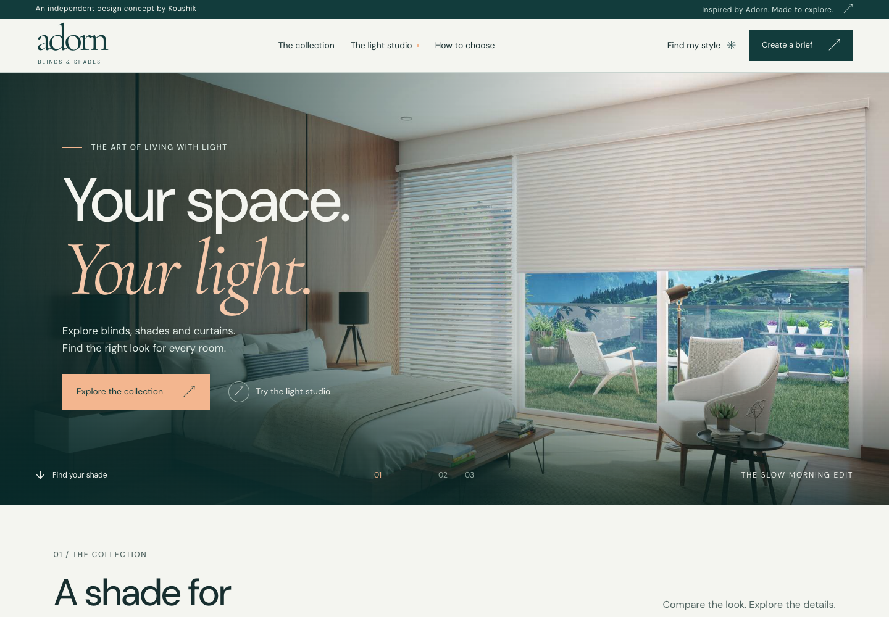

# ADORN · Window blinds website concept

A premium, responsive website demo by **Koushik** for pitching to blinds dealers and manufacturers. Midnight teal, porcelain and soft apricot give the catalogue a distinctive, contemporary showroom direction.



**Unofficial concept:** this is an independent portfolio demonstration, with no affiliation, commission or endorsement from AD Blinds or Adorn Blinds & Shades. The supplied [AD Blinds website](https://ad-blinds.com/) and [@adorn_blinds_shades](https://www.instagram.com/adorn_blinds_shades/) are creative references, not past clients. No sales figures, customer testimonials or business results are claimed.

## Open locally

Double-click `index.html`, or run this command from the project folder:

```sh
python3 -m http.server 48127
```

Visit **http://localhost:48127**. If that port is already serving another folder, stop that server first or choose another port.

There are no npm packages, installation steps or build commands. The site uses HTML, CSS, JavaScript and local assets.

## Demo features

- Browse the collection directly after the hero, filter larger product cards, switch between Room/Fabric views and open product details. Fabric views use original illustrative swatches.
- Expand a style comparison with visual directions and practical questions for your supplier.
- Try an original AI-created room photograph with illustrative blind overlays, fabric colours, an opening slider and daylight presets.
- Answer a short product finder and receive an illustrative starting recommendation.
- Create a three-step design brief and download it for discussion. Name and email are optional.
- Explore a responsive design with larger text, a mobile brief shortcut, subtle motion and support for the system reduced-motion preference.

**69 browser checks passed on 20 October 2026**, plus static checks and a direct-file smoke check. Verification includes loading all assets from a repository subdirectory like GitHub Pages. See the [verification record](docs/QA.md), [mobile preview](docs/mobile-preview.png) and [light studio](docs/light-studio-preview.png).

The studio photograph was generated with the built-in image tool; see its [creation prompt and asset path](docs/STUDIO-IMAGE-PROMPT.md). Blind overlays and fabric swatches are visual illustrations. They do not predict real fabric colour, dimensions, light transmission or installation results. Confirm product selections and actual samples with a supplier. **Downloading a brief does not send an enquiry, email or booking.** Production enquiry delivery is separate work.

## GitHub Pages hosting

1. Use the repository `koushik2002/adorn`. A public repository supports GitHub Pages on GitHub Free.
2. Upload the **contents** of this folder to its root. Keep `index.html`, `styles.css`, `theme.css`, `app.js` and `assets/` together; avoid an extra enclosing folder. If using the prepared ZIP, extract it first and upload the extracted files, not the ZIP itself.
3. Open **Settings → Pages → Build and deployment**. Choose **Deploy from a branch**.
4. Select **main** and **/(root)**, then **Save**.
5. After deployment, select **Visit site**. The project URL will resemble `https://koushik2002.github.io/adorn/`.

Relative asset paths support the repository URL. No backend or API keys are required for this demo. The deployment target is [koushik2002/adorn](https://github.com/koushik2002/adorn), with the website at [koushik2002.github.io/adorn/](https://koushik2002.github.io/adorn/).

The [publishing checklist](docs/GITHUB-PAGES.md) includes the exact upload layout and a live-site check. Official instructions: [configure a publishing source](https://docs.github.com/en/pages/getting-started-with-github-pages/configuring-a-publishing-source-for-your-github-pages-site) and [create a Pages site](https://docs.github.com/en/pages/getting-started-with-github-pages/creating-a-github-pages-site). Checked 20 October 2026.

## Adapt it for a client

| File | Edit |
| --- | --- |
| `index.html` | Brand, copy, navigation and consultation questions |
| `styles.css` | Typography, spacing and responsive layout |
| `theme.css` | Midnight teal, porcelain and soft apricot palette |
| `app.js` | Catalogue, preview controls, finder and brief behaviour |
| `assets/` | Approved photography, fonts and other local assets |

Use the [client pitch plan](docs/CLIENT-PITCH-PLAN.md) for the walkthrough, discovery and proposal scope. Before a commercial launch, obtain approved branding/photos, verify product and contact details, connect an agreed enquiry destination and test successful delivery. Agree privacy information and support responsibilities with the client.
